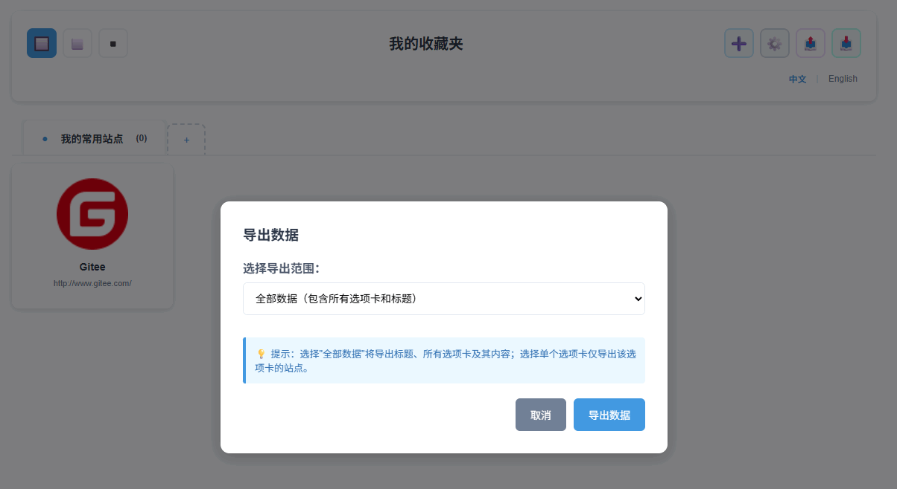
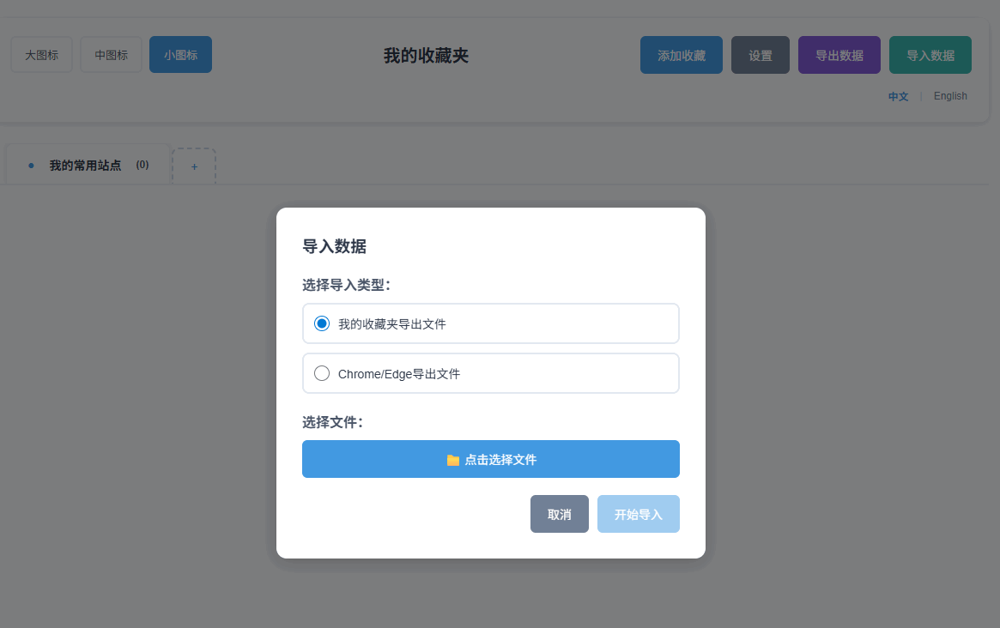
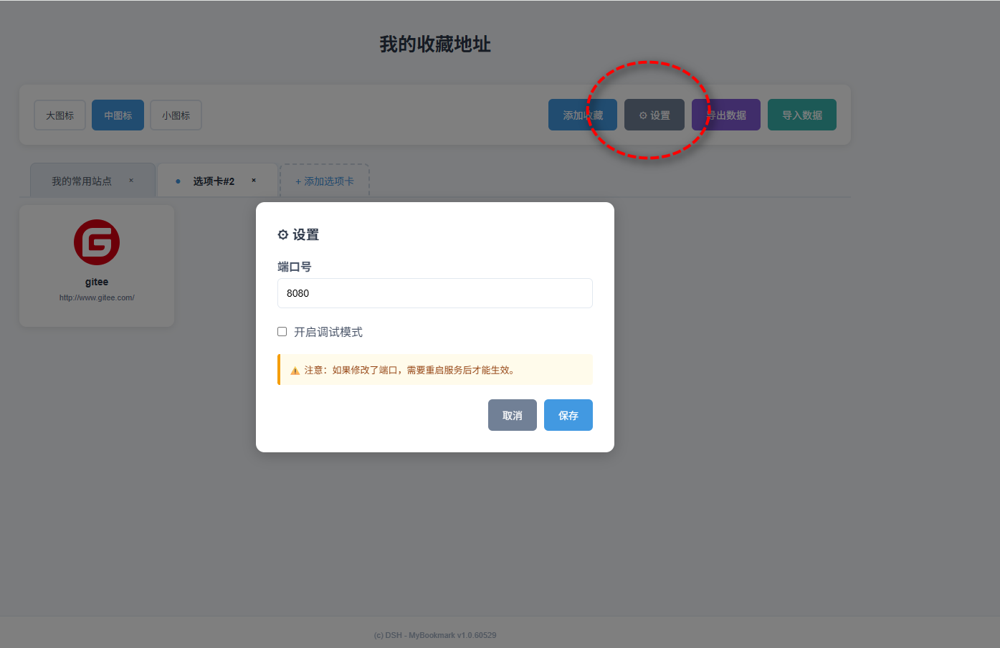

# 我的收藏地址 My Bookmark

## 功能

* 保存自己感兴趣的网站地址

* 所有数据都储存在本地文件中，信息绝对不会泄露！

* 基于 node.js 和 普通 html，无需数据库的支持

## 依赖

* node.js 最低版本 v8.x 或者更高，推荐 v12.x LTS 或更高版本

## 手动安装和运行

手动安装的方式：

* 搭建 node 环境

* 下载文件 mybookmark 文件

* Windows 下点击 start.bat 即可运行

* 更多安装和运行信息参见 [安装和运行](doc/install.md)

## 自动安装和运行

Windows 环境下，可以通过 MyBookmarkApp 服务管理程序，进行自动安装和运行：

* 参见 [MyBookmarkApp](https://gitee.com/dongatsh/dsh-mybookmark-app)

## 默认地址

* http://127.0.0.1:8080

## 运行界面

* 首页

* 添加站点

* 列表

* 支持数据导出

可以全部导出（包含标题等设置信息），也可选择某个选项卡进行导出。

* 支持数据导入

支持导入“我的收藏夹”的导出文件(json格式),也支持导入“Chrome/Edge浏览器”的收藏夹导出文件(html格式)。

* 支持国际化（中文和English)

* 设置

