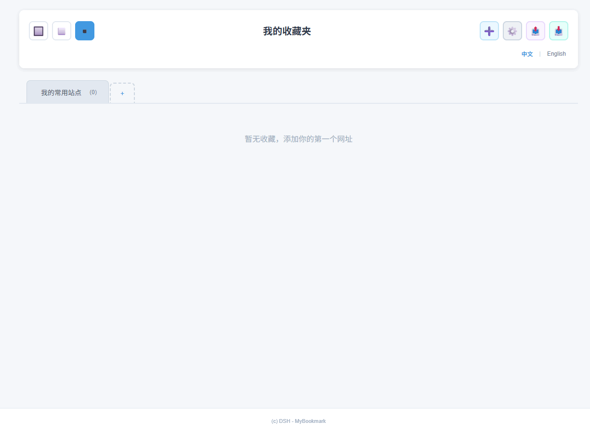
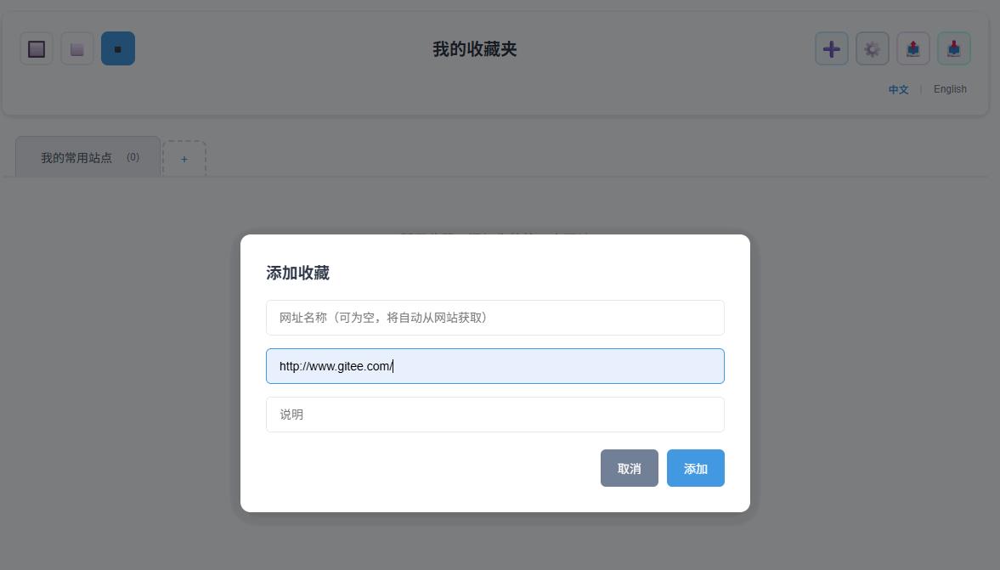
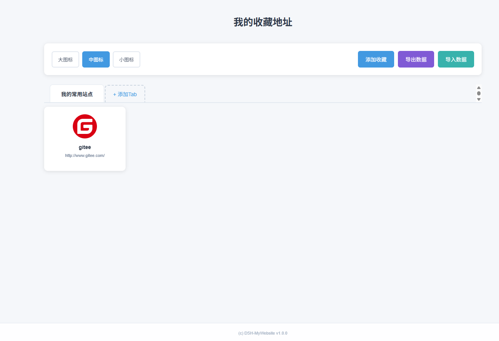
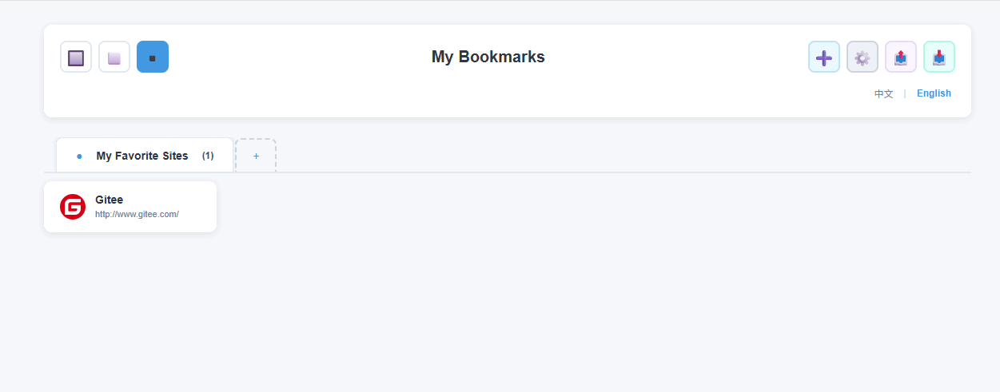

# 我的收藏地址 My Bookmark


## 功能

v1.0.0

* 保存自己感兴趣的网站地址

* 所有数据都储存在本地文件中，信息绝对不会泄露！

* 基于 node.js 和 普通 html，无需数据库的支持

## 依赖

* node.js 最低版本 v8.x 或者更高，推荐 v12.x LTS 或更高版本

## 安装

* 下载文件 mybookmark 文件

* 点击 start.bat 即可运行

## 默认地址

* http://127.0.0.1:8080

## 修改端口

* 修改 mybookmark/config.json 文件

```json
    {
        "port": 8080
    }
```

修改其中的 port，可改成需要的端口。

## 运行界面

* 首页



* 添加站点



* 列表



* 支持导出和导入

* 支持国际化（中文和English)



